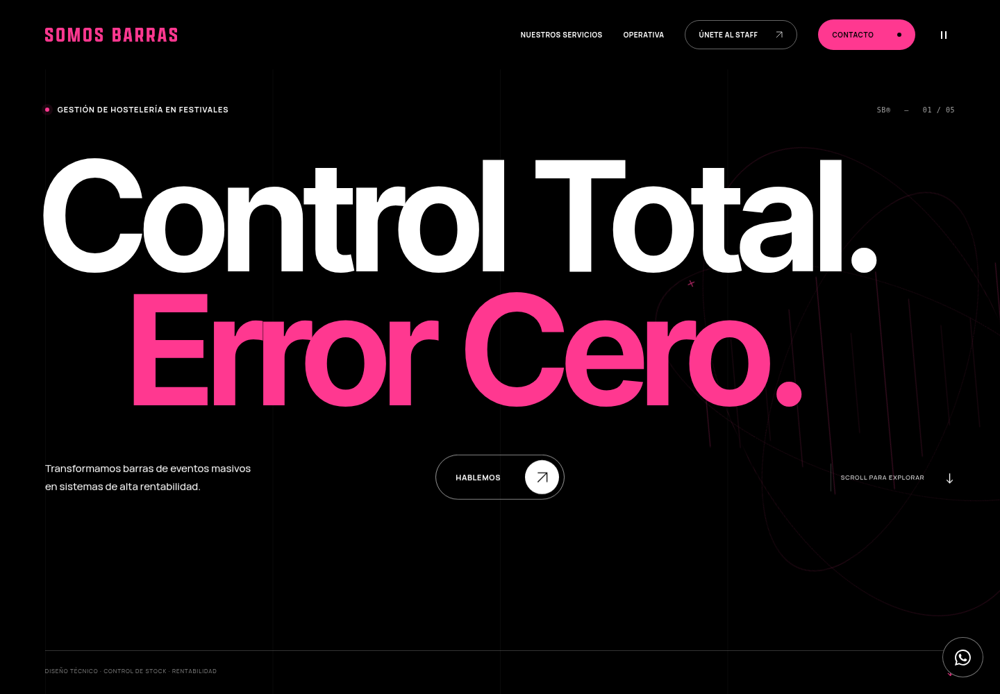

# Somos Barras

## Ver la web sin instalar nada

Descarga [SomosBarras.html](entrega/SomosBarras.html) y ábrelo con doble clic. En GitHub, utiliza el botón **Download raw** (flecha de descarga) de ese archivo. También puedes descargar [SomosBarras.zip](entrega/SomosBarras.zip), extraerlo y abrir `index.html`.

El archivo incluye las fotografías, el logotipo, las fuentes y todas las animaciones; la visualización funciona sin conexión.



Rediseño de una sola página con Vite, JavaScript sin framework, GSAP y Lenis. El contenido del HTML original y la paleta de marca se conservan: rosa `#ff3890`, blanco `#ffffff` y negro `#000000`.

## Desarrollo

Requiere Node.js **20.19+ de la rama 20, o 22.12+**; se recomienda **Node.js 24**.

```bash
npm ci
npm run dev
```

Otros comandos:

```bash
npm run build       # Genera dist/
npm run preview     # Sirve la compilación localmente
npm run test:e2e    # Compila y ejecuta las pruebas de Playwright
npm run export      # Genera entrega/SomosBarras.html y entrega/SomosBarras.zip
```

Playwright utiliza automáticamente Chromium del sistema en `/usr/bin/chromium`. Fuera de este entorno cloud, si no hay un navegador instalado:

```bash
npx playwright install chromium
```

Puede indicarse otro ejecutable mediante `PLAYWRIGHT_CHROMIUM_EXECUTABLE_PATH`.

## Estructura y experiencia

- `index.html`: nueva página; `src/style.css` y `src/main.js`: estilos e interacción.
- `index-2.html`: HTML original intacto, conservado como referencia.
- `public/assets/`: diagramas SVG originales del rediseño.
- `entrega/SomosBarras.html`: web autónoma para abrir con doble clic, sin instalar nada.
- `entrega/SomosBarras.zip`: la misma web como index.html, instrucciones y licencias de fuentes.
- `tests/`: comprobaciones de contenido, navegación, movimiento y chat en escritorio, móvil y movimiento reducido.

En escritorio, los servicios avanzan horizontalmente al hacer scroll vertical. En móvil, el recorrido es vertical y natural. La página respeta `prefers-reduced-motion` e incluye un control para pausar animaciones. El chat de WhatsApp dispone de etiquetas accesibles, control de foco, navegación por teclado y cierre con Escape.

Los enlaces de empleo y de información legal apuntan al dominio original `somosbarras.com`.

## Fotografías originales

Las seis fotografías y el logotipo se descargaron del sitio original tras aplicar la configuración de red. Las fotos se sirven localmente como WebP, con un máximo de 2048 px y sin cambiar su contenido; el logotipo PNG conserva sus bytes originales. Los atributos `data-original-src` mantienen las URL originales y `public/assets/media-manifest.json` registra procedencia, dimensiones y hashes SHA-256.

`npm run export` incrusta CSS, JavaScript, fuentes, diagramas, fotografías y logotipo en un único HTML. Puedes abrirlo directamente mediante `file://` y funciona sin conexión. Los enlaces a WhatsApp, correo, empleo y páginas legales siguen necesitando sus servicios correspondientes. El ZIP también incluye las licencias de las fuentes, que además están registradas en el HTML.

Las pruebas de la aplicación bloquean las imágenes deliberadamente para comprobar la reserva visual; las pruebas de la exportación verifican por separado que todas las imágenes y fuentes se cargan sin red ni servidor local.

El navegador administrado del entorno cloud bloquea la navegación `file://`. Por eso la prueba autónoma ejecuta los bytes exactos del HTML mediante `setContent`, sin red ni archivos adicionales; valida el contenido exportado, no el protocolo bloqueado del navegador cloud.

## Despliegue

Ejecuta `npm run build` y publica **solo el contenido de `dist/`** en un alojamiento estático. La configuración actual presupone despliegue en la raíz del dominio; para una subruta, ajusta primero `base` en Vite y las rutas absolutas de los recursos.
